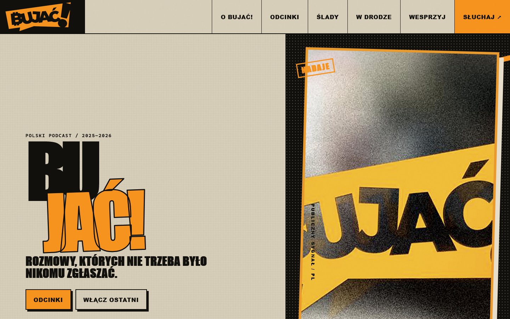

<div align="center">

# Bujać! 🎙️

**Niezależne polskie rozmowy o Bitcoinie, Nostrze i budowaniu poza systemem**

Publiczne archiwum odcinków podcastu: wszystkie rozmowy w jednym miejscu, z opisami i miniaturami. 🟠

[🌐 Strona archiwum](https://itstomekk.github.io/bujac-archiwum/) · [📜 Po co to jest?](https://itstomekk.github.io/bujac-archiwum/po-co-to-jest.html) · [🎧 Spotify](https://open.spotify.com/show/7JKCgH1nxriBsh6y9JlfOY) · [🟣 Nostr](https://primal.net/p/npub1adsudqw8jge35ff5g8vc7q6xqugpza3cxmaqm6fgk4uv0nd50gms4hn7pf) · [💬 Telegram](https://t.me/DwadziesciaJeden) · [🐛 Zgłoś błąd](https://github.com/itstomekk/bujac-archiwum/issues/new)

<br>

<a href="https://itstomekk.github.io/bujac-archiwum/"></a>

</div>

---

## 👋 Cześć!

**Bujać!** to polski podcast o pieniądzu, wolności i budowaniu poza systemem. Rozmawia po polsku o Bitcoinie, Nostrze, prywatności i własnych drogach komunikacji. Hasło programowe: *bo nikt nam nie może zabronić*.

To repozytorium to kod publicznego archiwum odcinków. Odtworzyliśmy je z kopii w Wayback Machine, publicznego RSS i stron Spotify, żeby wszystkie rozmowy dało się znaleźć w jednym miejscu: po sezonie, tytule, gościu i temacie. 🧡

## 🎧 Co tu znajdziesz

- 🎙️ **18 pozycji**, każda z opisem i miniaturą, a tam gdzie nagranie się zachowało, także z odtwarzaczem:
  - Sezon 1: 5 rozmów,
  - Sezon 2: 6 rozmów,
  - Docinki Niefiducjarne: 4 krótkie odcinki,
  - Sezon 3 (Laissez Faire): 3 rozmowy.
- 🔎 Wyszukiwarkę, która nie zwraca uwagi na polskie znaki, i filtry sezonów.
- 📜 Pełny tekst manifestu [„Po Co To Jest?”](https://itstomekk.github.io/bujac-archiwum/po-co-to-jest.html).
- 🧭 Ślady: skąd odcinki wzięły się w RSS, na Nostrze i na serwerach plików.

Strona jest statyczna, bez frameworka i bez trackerów. Odtwarzacz ładuje się dopiero po otwarciu odcinka.

## 🚧 Na jakim etapie jesteśmy

**Archiwum działa** i jest opublikowane na GitHub Pages. Pierwszy etap, czyli odzyskanie, budowa i publikacja, jest skończony.

**Planowane, jeszcze nie zrobione:**

- przeniesienie strony na framework (Astro albo Jekyll, decyzja jeszcze nie zapadła), bez zmiany adresów i identyfikatorów odcinków,
- transkrypcje, jeśli pojawią się publicznie,
- podpięcie domeny bujac.pl, jeśli jej właściciel będzie tego chciał.

## 🕳️ Czego nie wiemy

Niczego nie dopisujemy, żeby zakleić dziury:

- trzy docinki (#001-#003) przetrwały tylko jako wzmianki na stronie głównej, więc nie mają pełnego opisu,
- oryginalna data odcinka S2E10 się nie zachowała, więc strona pokazuje późniejszą datę ze Spotify i mówi o tym wprost,
- część plików z nagraniami nie przetrwała i jest oznaczona jako niedostępna do odtworzenia.

## 🤝 Chcesz pomóc?

Najbardziej przydadzą się ludzie, którzy te rozmowy znają:

- 🔍 **Poprawki:** zły tytuł, data, gość, literówka, martwy link.
- 🧩 **Brakujące kawałki:** pełne opisy docinków #001-#003, oryginalna data S2E10, publiczne kopie plików z nagraniami.
- 📝 **Transkrypcje**, jeśli masz prawo je udostępnić.
- 🛠️ **Kod:** pull requesty są mile widziane, a [DEVELOPMENT.md](DEVELOPMENT.md) mówi, jak uruchomić stronę i testy.

Otwórz [issue](https://github.com/itstomekk/bujac-archiwum/issues/new) z linkiem do źródła albo wpadnij na [czat Dwadzieścia Jeden](https://t.me/DwadziesciaJeden). Zasada jest jedna: opieramy się na źródłach, które da się sprawdzić.

## 🎨 Grafiki i prawa

Miniatury odcinków na stronie to grafiki wygenerowane przez AI. Pobrane publiczne okładki ze Spotify leżą w `assets/source-artwork/` razem z opisem pochodzenia.

**Kod** strony, skryptów i testów jest na licencji [MIT](LICENSE).

**Poza licencją zostają** teksty, opisy i nagrania odcinków, nazwa i logo podcastu oraz okładki ze Spotify. Prawa do nich mają ich twórcy. Miniatur odcinków też nie licencjonujemy: powstały z użyciem logo i okładki podcastu jako wzorca oraz z tytułów odcinków.

## 🛠️ Dla programistów

```bash
python -m http.server 4173
node --test tests/*.test.mjs
python scripts/audit.py
```

Struktura katalogów, katalog odcinków w `data/episodes.json` i reszta: [DEVELOPMENT.md](DEVELOPMENT.md).

---

<details>
<summary>🇬🇧 In English</summary>

**Bujać!** is an independent Polish podcast about Bitcoin, Nostr, privacy and building outside the system. This repo is the source of a public, static, framework-free archive of its episodes, rebuilt from Wayback Machine captures, the public RSS feed and Spotify metadata: [itstomekk.github.io/bujac-archiwum](https://itstomekk.github.io/bujac-archiwum/).

It is live on GitHub Pages and lists 18 items (Season 1: 5, Season 2: 6, four short "Docinki Niefiducjarne", Season 3: 3) with descriptions, thumbnails (AI-generated), search and an inline player where a recording survives. Gaps are labelled, not filled in: three Docinki have no full public description, the original date of S2E10 did not survive, and some media files are gone. A move to a framework (Astro or Jekyll) is planned but not started.

Spotted a mistake or have a source for a missing piece? [Open an issue](https://github.com/itstomekk/bujac-archiwum/issues/new). The code is MIT licensed ([LICENSE](LICENSE)); no license is asserted over the texts, recordings, podcast name and artwork, or episode thumbnails. Build notes: [DEVELOPMENT.md](DEVELOPMENT.md).

</details>

<div align="center">

**Internet należy do nas.** ⚡

</div>
